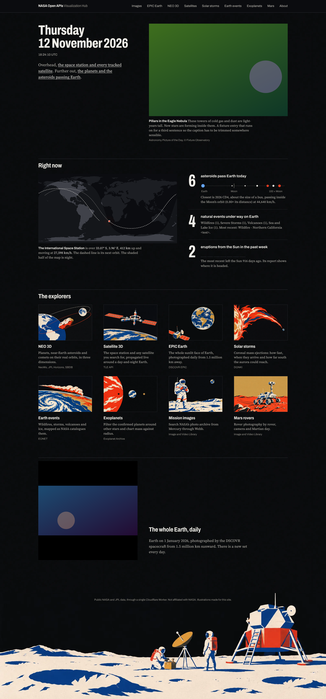

# NASA Open APIs Visualization Hub

Interactive explorers built on public NASA and JPL data, served as a static site from GitHub Pages
with a single Cloudflare Worker as the API proxy.



_Rendered by the smoke tests against placeholder fixtures, so imagery is stand-in art._

| Page | What it shows |
| --- | --- |
| Home | Astronomy Picture of the Day, the live ISS position, today's asteroid flybys, open natural events and this week's solar eruptions |
| Images Explorer | Search across the NASA Image and Video Library |
| EPIC Earth | Daily full-disc Earth imagery from DSCOVR, with playback |
| Mars Images | Rover imagery by rover, instrument, sol and year |
| NEO 3D | Planets, near-Earth objects and comets in a heliocentric three.js scene, with JPL SBDB search and a Wow! Signal overlay (toggle with <kbd>W</kbd>) |
| Satellite 3D | Live SGP4 tracking of satellites from two-line elements |
| CME Explorer | DONKI coronal mass ejection reports with arrival and aurora charts |
| EONET Explorer | Natural events on a map |
| Exoplanet Explorer | Filterable queries against the NASA Exoplanet Archive |

## Develop

```bash
pnpm install
pnpm dev        # http://localhost:5173/NASA/
pnpm check      # typecheck, lint, build, smoke tests
```

The smoke tests run every page in Chromium against mocked network. If Playwright has no browser
yet, run `pnpm exec playwright install chromium` once.

See [AGENTS.md](AGENTS.md) for the code layout and conventions.

## Deploy

Pushing to `main` builds and publishes the site through `.github/workflows/pages.yml`. The Worker
in `worker.js` is deployed separately in Cloudflare and needs the `NASA_API` secret.

## Data sources

NASA Open APIs (APOD, NeoWs, EPIC, Image and Video Library, DONKI, EONET), JPL Horizons and the
Small-Body Database, the NASA Exoplanet Archive, and the TLE API. This project is not affiliated
with NASA.
